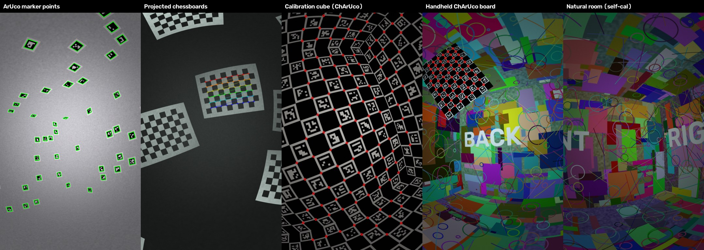
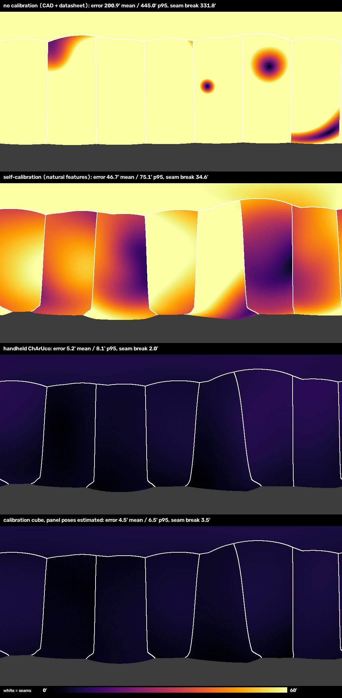
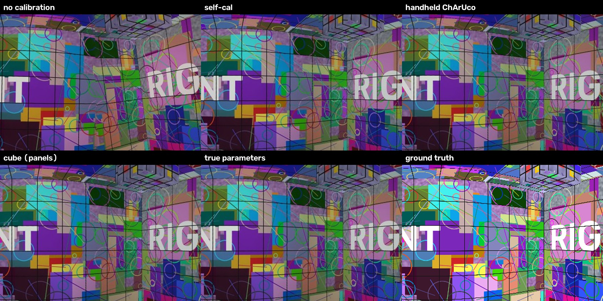
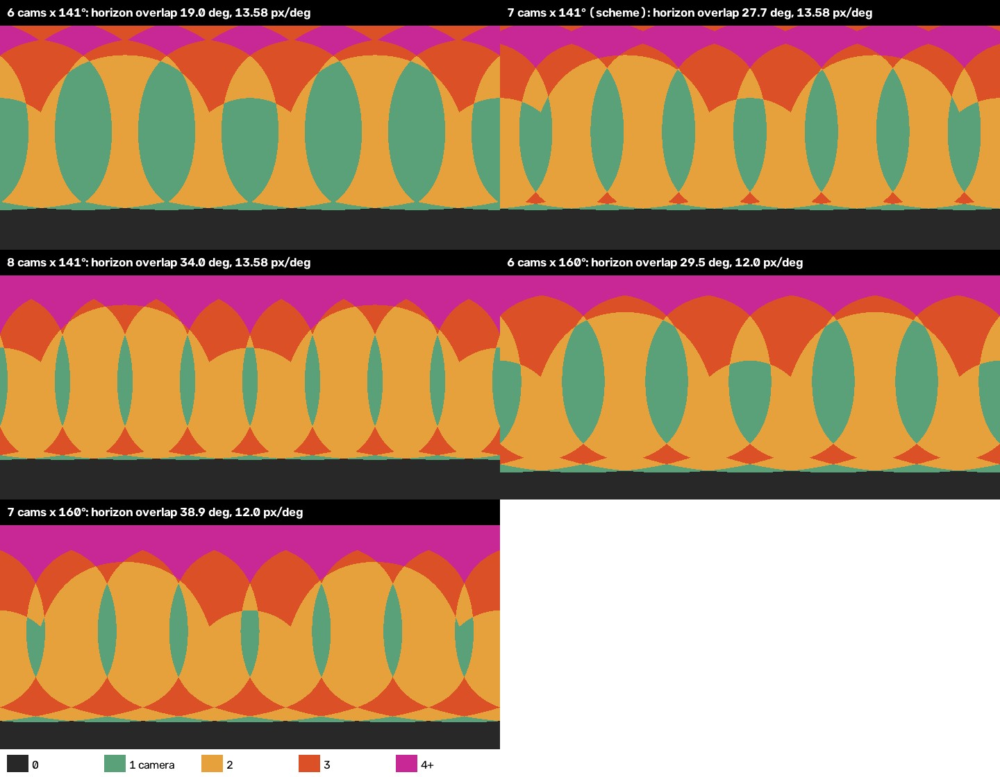
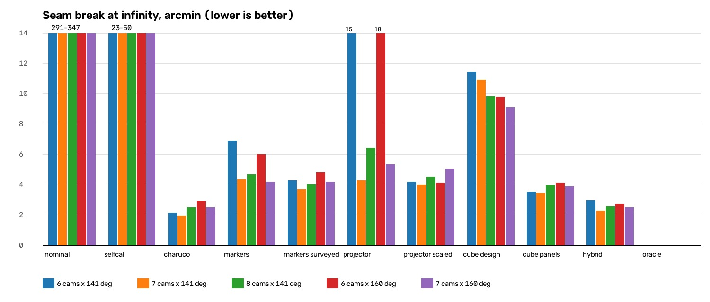
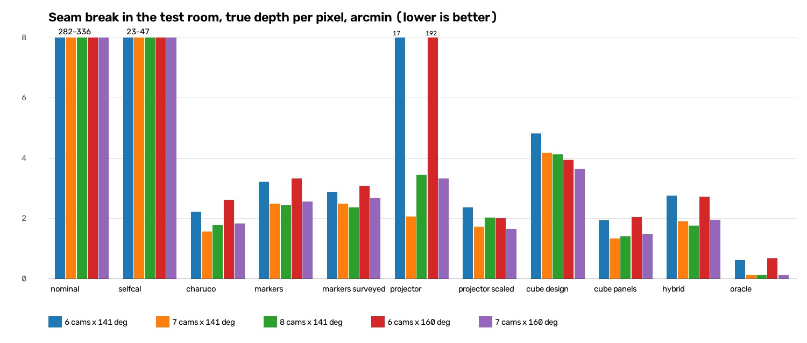
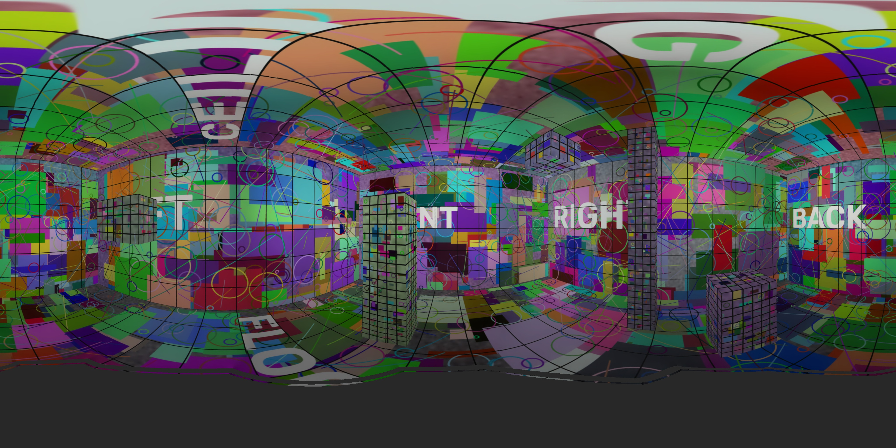
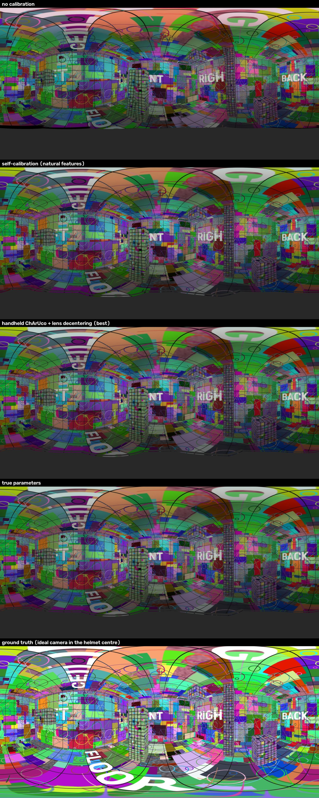
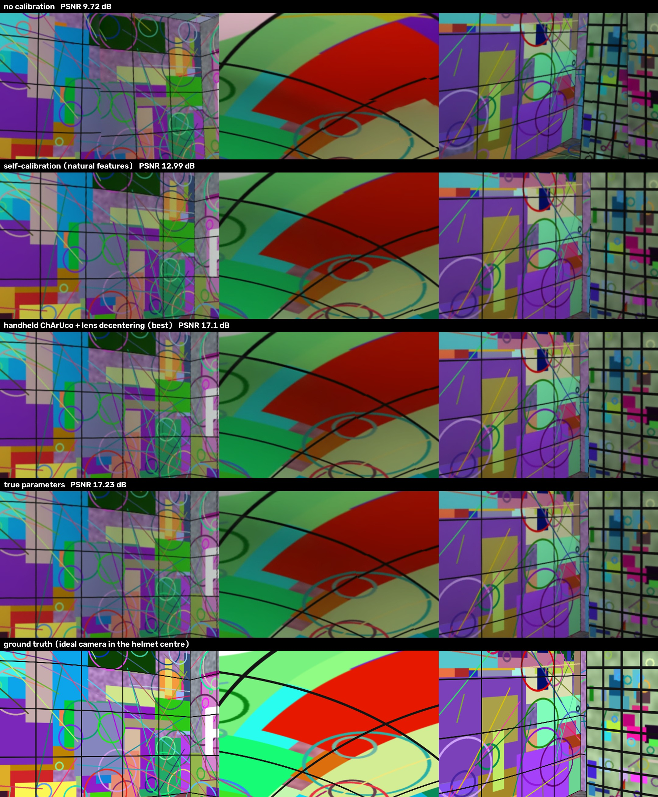

# Калибровка каски: стенды, методы и перекрытие камер

Код: [`Tools/calib_lab/`](../Tools/calib_lab) (модель камер, стенды, методы, оценка), общая связка [`Tools/smart_helmet_pano/bundle.py`](../Tools/smart_helmet_pano/bundle.py), детекторы целей [`targets.py`](../Tools/smart_helmet_pano/targets.py), рабочая калибровка по доске [`target_calib.py`](../Tools/smart_helmet_pano/target_calib.py).
Сырые цифры: [`Docs/results/calibration_study.json`](results/calibration_study.json).

## Коротко

- Сравнили **9 способов калибровки** каски на **5 вариантах перекрытия камер** (6–8 камер, объективы 141° и 160°, перекрытие соседей 19–39°). Камеры смоделированы с неточностями реального железа: установка с ошибкой до 7.5°, главная точка смещена до 32 px, у каждого объектива своя кривая, есть децентровка линз.
- **Без калибровки** разрыв на швах 5.5°, **текущая самокалибровка по сцене** — 30–47′ (6–9 px при 4096). **Стенды с мишенями** дают 2–9′, средняя ошибка поворота камер 0.04–0.2°. Исключения — куб, собранный «по чертежу», и проектор без рулетки.
- **Лучший практичный способ — ручная ChArUco-доска:** разрыв на швах 2.0′, а с моделью объектива p1, p2 — **0.5′, то есть 0.1 px**. **Калибровочный куб** снимается быстрее всех (4 позы) с сопоставимой точностью, но положение его панелей нужно оценивать: куб «по чертежу» в 2–3 раза хуже. **Маркерным точкам** не нужно измерять координаты. **Проецируемым шахматкам** нужна одна рулетка, без неё на 6 камерах они дают 15–18′.
- **Перекрытие 19–39° на точность калибровки почти не влияет.** Оно важно для реальной сцены: у 7–8 камер меньше параллакса и заслонений, чем у 6. **Наименьшее искажение панорамы** дают 7–8 камер × 141° или 7 × 160° вместе с калибровкой по мишеням и сшивкой в режиме «глубина». Текущая схема 7 × 141° уже в этой зоне.
- **В помещении параллакс** при сшивке на сфере (57′) в 15–30 раз больше ошибки хорошей калибровки. Точная калибровка раскрывается только вместе с режимом «глубина».
- **После сдвига креплений на ~1°** лабораторная калибровка устаревает (77′ на швах). Лабораторный объектив плюс повороты по обычным кадрам возвращают 1.5–3′.
- **Итоговая панорама** после ChArUco + p1, p2 в режиме «глубина» почти совпадает со сшитой по истинным параметрам: PSNR 17.1 против 17.2 дБ ([раздел](#итоговые-панорамы-после-калибровки)).
- В конвейер добавлены команды `board`, `calibrate-board`, `refine-mounts`, такие же MCP-инструменты, модель объектива с децентровкой и проверка в `check_all.py`.

## Как проводили

Стенды построены трассировкой лучей на Python, без Unreal (редактор с MCP для этой работы не запускался). Для калибровки это даже точнее: геометрия задана аналитически, истина известна до микрона, каждый луч выходит из настоящего центра своей линзы (10.5 см от центра каски), значит параллакс между камерами настоящий. Каждый кадр проходит через «истинную» камеру со всеми неточностями, затем через тот же OpenCV-детектор, что пойдёт на реальные снимки.

### Неточности камер (как у реального железа)

Номинал — то, что знает конвейер: чертёж каски и паспорт объектива (эквидистантный fisheye, главная точка в центре, углы установки по схеме). «Истинная» каска собирается по seed:

| Что | Модель | Разброс |
|---|---|---|
| Кривая объектива | конструкция отличается от эквидистанты (между эквидистантой и равнотелесной), паспортный FOV держится на краю | k_base = (−0.035, 0.004, −0.0005, 0) |
| Объектив к объективу | свои k1..k4 у каждой линзы | σ k1 = 0.010, k2 = 0.004, k3 = 0.0015, k4 = 0.0005 |
| Фокус | разброс сборки | σ 1.5 % |
| Главная точка | допуск держателя M12 | σ 15 px по каждой оси |
| Децентровка (тангенциальная дисторсия) | в исходной модели Kannala-Brandt конвейера её нет; в этой работе модель расширена p1, p2 | σ p1, p2 = 4·10⁻⁴ (≈1 px у края) |
| Пиксель | отношение сторон | σ 0.1 % |
| Установка камеры | поворот | σ 3° по каждой оси |
| Центр линзы | смещение | σ 2 мм по каждой оси |
| Фотометрия | экспозиция, баланс белого, виньетирование, шум, размытие объектива | σ 0.4 ступени, 6 %, cos⁴ 0.3–0.6, σ 2, σ 0.7 px |

## Стенды и методы


*Вид из одной камеры на каждом стенде, зелёным и красным — найденные метки.*

| Метод | Что нужно | Съёмка | Что оценивается |
|---|---|---|---|
| **Ручная ChArUco-доска** | доска 11×8 клеток по 50 мм (A2, 570×420 мм), `python -m smart_helmet_pano board` | каска неподвижна; доска 14 раз перед каждой камерой (включая края кадра) и 5 раз в каждой зоне перекрытия соседей (кольцо–кольцо и кольцо–верх) | объектив каждой камеры, установка, поза каждого положения доски |
| **Маркерные точки ArUco** | ~150 маркеров 15 см, наклеенных куда попало на стены и потолок комнаты 6×5×3 м | каска на штативе, 8 поз (поворот по азимуту почти на 2 шага кольца, наклон до ±24°, крен до ±12°) | то же + координаты всех маркеров + поза каски; масштаб по размеру маркера |
| **Маркерные точки, координаты измерены** | то же + съёмка тахеометром (σ 2 мм) | то же | то же, координаты маркеров держатся у измеренных |
| **Шахматки, спроецированные на стены** | проектор на стойке, 14 направлений: 2 на каждую стену, 4 на потолок, 2 на пол; доски 10×7 клеток 1–1.6 м, с трапецией от косой проекции | 10 поз штатива; оператор знает только «на какой стене примерно доска» | то же + углы досок (неизвестны), каждая доска лежит в плоскости стены |
| **Квадратная комната-куб, по чертежу** | куб 3×3×3 м, на всех гранях ChArUco 12×12 клеток по 25 см; собран с ошибками ±3 мм, ±0.15°, печать ±0.07 % | 4 позы штатива в центре | объектив, установка, позы; координаты углов берутся из чертежа |
| **Квадратная комната-куб, панели оцениваются** | тот же куб | те же кадры | то же, но положение каждой грани оценивается (печать точная, монтаж нет) |
| **Самокалибровка по сцене** | ничего, обычная комната | 8 обычных кадров с разных мест | текущий `calibrate.py`: общий объектив + по камере, повороты; главная точка в центре |
| **Гибрид** | объектив из ChArUco-калибровки | 8 обычных кадров | объектив закреплён, повороты и центры по совпадениям SIFT |

Детекция идёт по сырым fisheye-кадрам: ArUco (уточнение AprilTag), ChArUco (седловые точки), шахматки (`findChessboardCornersSB`, для бледных проецируемых досок — классический детектор с субпиксельным уточнением; ориентация по цвету четырёх угловых клеток). Всё решается одной связкой (`bundle.py`): разреженный Левенберг–Марквардт, Хьюбер, сначала паспортный объектив, затем всё вместе.

## Как оценивали

- **Ошибка калибровки.** Поворот каждой камеры и центр линзы против истины; **ошибка луча** — угол между истинным и оценённым лучом каждого пикселя по всему кадру (после общего поворота каски, который на швы не влияет). Единица — угловая минута: 1′ = 1/60°; в панораме 4096 px один пиксель = 5.3′.
- **Искажение панорамы, точно.** Для каждого пикселя панорамы сшивка выбирает пиксель камеры по оценённой калибровке; мы трассируем **истинный** луч этого пикселя в сцену и смотрим, куда он попадает на самом деле. *Искажение* — угол между тем, куда должен смотреть пиксель панорамы, и куда смотрит. *Разрыв на швах* — угол между двумя камерами на линии шва: это видимый «излом» прямых.
  - **∞** — точки на бесконечности: только калибровка, без параллакса;
  - **комната, прокси-сфера 3 м** — тестовая комната 6×5×3 м с мебелью на 0.8–2 м, как в базовом режиме сшивки;
  - **комната, точная глубина** — каждый пиксель ставится на свою истинную дальность (идеальный режим «глубина»), остаётся только ошибка калибровки при настоящих дистанциях.
- **Изображение.** PSNR и SSIM сшитой тестовой комнаты против эталонной панорамы из центра каски; артефакты по критерию программы испытаний (< 10 % центральной площади).

## Результаты: схема 7 × 141°

| Метод | Поворот камер, ° (ср. / макс.) | Центр линзы, мм | Ошибка луча, ′ | Искажение панорамы ∞, ′ (ср. / p95) | Разрыв на швах ∞, ′ (ср. / p95) | Швы при точной глубине, ′ | PSNR при точной глубине, дБ | Съёмка |
|---|---|---|---|---|---|---|---|---|
| Без калибровки (чертёж + паспорт объектива) | 4.02 / 7.56 | 4.4 | 208.9 | 200.9 / 445.0 | 331.8 / 707.6 | 319.7 | 10.20 | — |
| Самокалибровка по сцене (текущий конвейер) | 1.29 / 2.57 | 5.9 | 57.2 | 46.7 / 75.1 | 34.6 / 69.5 | 37.2 | 12.48 | 8 обычных кадров |
| Ручная ChArUco-доска | 0.08 / 0.17 | 1.3 | 5.4 | 5.2 / 8.1 | 2.0 / 4.2 | 1.6 | 17.41 | 182 положений доски (544 кадров) |
| Маркерные точки ArUco, координаты неизвестны | 0.06 / 0.08 | 2.7 | 6.1 | 6.2 / 8.8 | 4.4 / 9.0 | 2.5 | 17.99 | 8 поз штатива |
| Маркерные точки, координаты измерены | 0.06 / 0.09 | 2.9 | 6.2 | 6.4 / 9.9 | 3.7 / 7.6 | 2.5 | 17.92 | 8 поз штатива + съёмка тахеометром |
| Шахматки, спроецированные на стены | 0.07 / 0.12 | 3.3 | 5.5 | 4.6 / 7.7 | 4.3 / 8.9 | 2.1 | 18.09 | 10 поз штатива × 14 направлений проектора |
| Шахматки на стенах + рулетка (ширина каждой доски) | 0.08 / 0.12 | 3.3 | 4.8 | 4.5 / 8.1 | 4.0 / 7.8 | 1.7 | 18.08 | то же + 28 замеров рулеткой |
| Квадратная комната-куб, геометрия по чертежу | 0.32 / 0.77 | 6.0 | 14.9 | 8.8 / 20.4 | 10.9 / 19.3 | 4.2 | 16.24 | 4 позы в кубе |
| Квадратная комната-куб, положение панелей оценивается | 0.04 / 0.06 | 1.9 | 4.3 | 4.5 / 6.5 | 3.5 / 5.9 | 1.4 | 18.21 | 4 позы в кубе |
| ChArUco-объектив + повороты по сцене | 0.09 / 0.20 | 1.7 | 5.9 | 5.5 / 9.9 | 2.3 / 4.5 | 1.9 | 17.35 | 8 обычных кадров + объектив из ChArUco |
| Истинные параметры (предел) | 0.00 / 0.00 | 0.0 | 0.0 | 0.3 / 1.0 | 0.0 / 0.0 | 0.1 | 18.81 | — |

*«Швы при точной глубине» — разрыв на швах в тестовой комнате, когда каждый пиксель ставится на свою дальность: так работает идеальный режим «глубина», остаётся только ошибка калибровки. 1′ ≈ 0.19 px панорамы 4096.*


*Искажение панорамы на бесконечности по всей сфере (0–60′), белые линии — швы. Сверху вниз: без калибровки, самокалибровка, ручная ChArUco-доска, куб с оценкой панелей.*


*Шов между cam0 и cam1, тестовая комната, сшивка по точной глубине. Без калибровки и после самокалибровки линии сетки ломаются на шве, после калибровки по мишеням — нет.*

**Что видно:**
1. **Без калибровки панорама непригодна:** 3.3° искажения, разрывы на швах 5.5° (≈ 63 px при 4096). Ошибки установки 2.6–7.5° и фокус, отличающийся от паспортного на 3–6 %, не прощаются.
2. **Самокалибровка по сцене (текущий конвейер) даёт 35–47′ (≈ 7–9 px на шве).** Она не умеет оценивать главную точку (у M12-держателя смещение до 32 px), а разную кривую объективов по одной сцене не разделить. Это совпадает с выводом [RESULTS.md](RESULTS.md) по реальной каске.
3. **Стенды с мишенями (кроме куба «по чертежу») дают 2–5′ на швах (0.4–0.9 px) и 4–6′ абсолютного искажения**, на порядок лучше самокалибровки. Повороты камер — 0.04–0.09°, центры линз — 1–3 мм.
4. **Лучшие швы — ручная ChArUco-доска (2.0′) и гибрид (2.3′).** Доска, поставленная в зону перекрытия двух камер, прямо связывает их между собой. **Лучшее абсолютное искажение — куб с оценкой панелей (4.3′ луча, 1.4′ на швах при точной глубине)** при самой быстрой съёмке (4 позы).
5. **Куб «по чертежу» в 2–3 раза хуже (10.9′ на швах).** Ошибка сборки ±3 мм на расстоянии 1.5 м — это уже 1–2 px, связка размазывает её по фокусу и поворотам. Геометрию стенда нужно оценивать, а не брать из чертежа.
6. **Маркерные точки без измерения координат (6.2′/4.4′) почти не уступают измеренным тахеометром (6.4′/3.7′).** Тахеометр не нужен, связка сама находит положения маркеров.
7. **Проецируемые шахматки на схеме работают (4.6′/4.3′),** но у них нет метрического масштаба. На 6 камерах это давало 15–18′ на швах. Одна рулетка (ширина каждой доски, 28 замеров) плюс слабая регуляризация объектива исправляют это на всех вариантах: 4.0–5.1′.

### Ошибка луча по полю кадра

| Метод | 0-15° | 15-30° | 30-45° | 45-60° | 60-75° | 75-90° |
|---|---|---|---|---|---|---|
| Без калибровки (чертёж + паспорт объектива) | 192.4 | 205.4 | 211.4 | 201.0 | 197.0 | 234.7 |
| Самокалибровка по сцене (текущий конвейер) | 49.2 | 49.1 | 49.1 | 48.1 | 51.6 | 138.4 |
| Ручная ChArUco-доска | 5.8 | 5.8 | 5.6 | 5.2 | 4.9 | 4.9 |
| Маркерные точки ArUco, координаты неизвестны | 6.2 | 6.2 | 6.2 | 6.0 | 5.8 | 6.8 |
| Маркерные точки, координаты измерены | 6.6 | 6.5 | 6.4 | 6.0 | 5.6 | 6.3 |
| Шахматки, спроецированные на стены | 4.4 | 4.5 | 4.7 | 4.9 | 5.8 | 11.7 |
| Шахматки на стенах + рулетка (ширина каждой доски) | 4.4 | 4.5 | 4.5 | 4.7 | 5.2 | 6.5 |
| Квадратная комната-куб, геометрия по чертежу | 9.3 | 10.2 | 11.0 | 12.1 | 14.1 | 51.0 |
| Квадратная комната-куб, положение панелей оценивается | 5.0 | 4.8 | 4.5 | 4.0 | 3.3 | 4.0 |
| ChArUco-объектив + повороты по сцене | 6.3 | 6.2 | 6.0 | 5.6 | 5.2 | 5.3 |

У всех методов на мишенях ошибка почти одинакова от центра до края кадра (4–7′ ≈ 1–1.5 px). Это **не шум и не нехватка данных, а предел модели объектива:** у реальных линз есть децентровка (тангенциальная дисторсия), а исходная модель Kannala-Brandt конвейера её не описывает. Самокалибровка и куб «по чертежу» к краю кадра резко ухудшаются (51–138′ на 75–90°).

### Модель объектива: децентровка

Предел 4–7′ у всех стендов — децентровка линз, которой нет в модели Kannala-Brandt. Модель конвейера расширена двумя коэффициентами p1, p2 (`rig.py`, `bundle.py`). Старые `rig.json` читаются как раньше, у них p = 0. Те же кадры пересчитаны с новой моделью:

| Метод | Экземпляр | Ошибка луча, ′ | Искажение ∞, ′ | Разрыв на швах ∞, ′ | Швы при точной глубине, ′ |
|---|---|---|---|---|---|
| Ручная ChArUco-доска | seed 1 | 5.4 → **1.7** | 5.2 → **1.5** | 2.0 → **0.5** | 1.6 → **0.5** |
| Квадратная комната-куб, положение панелей оценивается | seed 1 | 4.3 → **1.5** | 4.5 → **1.3** | 3.5 → **1.8** | 1.4 → **1.0** |
| Шахматки на стенах + рулетка (ширина каждой доски) | seed 1 | 4.8 → **4.3** | 4.5 → **3.2** | 4.0 → **3.0** | 1.7 → **1.2** |
| Маркерные точки ArUco, координаты неизвестны | seed 1 | 6.1 → **4.9** | 6.2 → **4.6** | 4.4 → **4.6** | 2.5 → **2.3** |
| Ручная ChArUco-доска | seed 2 | 6.1 → **3.1** | 6.5 → **2.9** | 6.5 → **1.1** | 4.1 → **1.0** |
| Квадратная комната-куб, положение панелей оценивается | seed 2 | 7.4 → **2.7** | 7.8 → **2.5** | 8.8 → **3.1** | 2.9 → **1.6** |
| Шахматки на стенах + рулетка (ширина каждой доски) | seed 2 | 17.3 → **3.7** | 7.5 → **3.4** | 8.6 → **4.1** | 3.8 → **2.1** |
| Маркерные точки ArUco, координаты неизвестны | seed 2 | 7.1 → **4.3** | 6.8 → **3.6** | 6.8 → **5.0** | 4.3 → **2.7** |

- **Больше всех выигрывает ChArUco-доска:** швы 0.5–1.1′ (0.1–0.2 px при 4096), искажение 1.5–2.9′. Доска близко, углы седловые и точные, их много по всему кадру, так что данных хватает, чтобы отделить децентровку от остальных параметров.
- Куб и проектор улучшаются в 1.3–3.5 раза.
- Маркерам ArUco модель почти не помогает: их ограничивает точность углов маркера (0.3–0.6 px против 0.03–0.15 px у шахматных углов).
- `calibrate-board` оценивает p1, p2 по умолчанию. `refine-mounts` с таким объективом после дрейфа креплений даёт 1.5′ на швах против 2.8′ со старой моделью.

### Параллакс важнее калибровки, если сшивать на сфере

| Метод | Разрыв на швах, ′ | PSNR, дБ | SSIM | Артефакты без потока, % | Артефакты с потоком, % |
|---|---|---|---|---|---|
| Без калибровки (чертёж + паспорт объектива) | 339.5 | 10.16 | 0.253 | 1.34 | 1.14 |
| Самокалибровка по сцене (текущий конвейер) | 56.0 | 12.36 | 0.364 | 0.34 | 0.28 |
| Ручная ChArUco-доска | 57.6 | 14.05 | 0.550 | 0.40 | 0.35 |
| Маркерные точки ArUco, координаты неизвестны | 56.6 | 14.15 | 0.560 | 0.39 | 0.36 |
| Маркерные точки, координаты измерены | 57.6 | 14.10 | 0.556 | 0.40 | 0.36 |
| Шахматки, спроецированные на стены | 58.3 | 14.15 | 0.566 | 0.40 | 0.35 |
| Шахматки на стенах + рулетка (ширина каждой доски) | 57.5 | 14.16 | 0.567 | 0.40 | 0.35 |
| Квадратная комната-куб, геометрия по чертежу | 57.3 | 14.03 | 0.538 | 0.39 | 0.33 |
| Квадратная комната-куб, положение панелей оценивается | 57.5 | 14.17 | 0.568 | 0.39 | 0.35 |
| ChArUco-объектив + повороты по сцене | 57.6 | 14.05 | 0.551 | 0.40 | 0.35 |
| Истинные параметры (предел) | 57.6 | 14.29 | 0.583 | 0.40 | 0.36 |

В комнате с мебелью на 0.8–2 м базовая сшивка на сфере 3 м даёт **57′ разрыва у всех методов, даже у истинных параметров.** Это параллакс между линзами, разнесёнными на 10.5 см от центра, и он в 15–30 раз больше ошибки хорошей калибровки. Поэтому точная калибровка раскрывается только вместе с режимом «глубина» ([RESULTS.md](RESULTS.md)): при точной глубине швы 1.4–2.5′ против 37′ у самокалибровки. Артефакты по критерию программы испытаний (< 10 %) у всех методов меньше 0.5 %: критерий на таких разрывах не срабатывает, он ловит только грубые ошибки.

## Перекрытие: какой вариант даёт наименьшее искажение

| Вариант | Камер | Поле кадра, ° (Г × В) | px/° | Перекрытие соседей на горизонте, ° | Перекрытие кольца и верхней, ° | Покрытие сферы, % | Двойное покрытие, % |
|---|---|---|---|---|---|---|---|
| 6 камер × 141° | 7 | 79.5 × 141.4 | 13.58 | 19.0 | 47.8 | 93.7 | 52.7 |
| 7 камер × 141° (схема) | 8 | 79.5 × 141.4 | 13.58 | 27.7 | 47.9 | 93.7 | 70.0 |
| 8 камер × 141° | 9 | 79.5 × 141.4 | 13.58 | 34.0 | 48.0 | 93.8 | 83.0 |
| 6 камер × 160° | 7 | 90.0 × 160.0 | 12.0 | 29.5 | 65.1 | 97.0 | 71.6 |
| 7 камер × 160° | 8 | 90.0 × 160.0 | 12.0 | 38.9 | 65.1 | 97.1 | 87.5 |


*Сколько камер видит каждое направление (эквипрямоугольная проекция, низ — надир). Зелёный — одна камера, оранжевый — две.*

**Разрыв на швах на бесконечности, ′** (только калибровка; жирным — лучший вариант перекрытия для каждого метода):

| Метод \ вариант | 6 камер × 141° | 7 камер × 141° (схема) | 8 камер × 141° | 6 камер × 160° | 7 камер × 160° |
|---|---|---|---|---|---|
| Без калибровки (чертёж + паспорт объектива) | **291.3** | 331.8 | 307.0 | 306.5 | 347.2 |
| Самокалибровка по сцене (текущий конвейер) | 42.3 | 34.6 | 49.8 | **22.7** | 34.6 |
| Ручная ChArUco-доска | 2.1 | **2.0** | 2.5 | 2.9 | 2.5 |
| Маркерные точки ArUco, координаты неизвестны | 6.9 | 4.4 | 4.7 | 6.0 | **4.2** |
| Маркерные точки, координаты измерены | 4.3 | **3.7** | 4.1 | 4.8 | 4.2 |
| Шахматки, спроецированные на стены | 14.7 | **4.3** | 6.5 | 18.3 | 5.4 |
| Шахматки на стенах + рулетка (ширина каждой доски) | 4.2 | **4.0** | 4.5 | 4.1 | 5.1 |
| Квадратная комната-куб, геометрия по чертежу | 11.5 | 10.9 | 9.9 | 9.8 | **9.1** |
| Квадратная комната-куб, положение панелей оценивается | 3.6 | **3.5** | 4.0 | 4.1 | 3.9 |
| ChArUco-объектив + повороты по сцене | 3.0 | **2.3** | 2.6 | 2.8 | 2.5 |
| Истинные параметры (предел) | **0.0** | **0.0** | **0.0** | **0.0** | **0.0** |



**Разрыв на швах в тестовой комнате при точной глубине, ′** (калибровка + заслонения за близкими предметами):

| Метод \ вариант | 6 камер × 141° | 7 камер × 141° (схема) | 8 камер × 141° | 6 камер × 160° | 7 камер × 160° |
|---|---|---|---|---|---|
| Без калибровки (чертёж + паспорт объектива) | **281.8** | 319.7 | 294.2 | 293.8 | 336.1 |
| Самокалибровка по сцене (текущий конвейер) | 40.5 | 37.2 | 47.1 | **22.7** | 37.4 |
| Ручная ChArUco-доска | 2.2 | **1.6** | 1.8 | 2.6 | 1.8 |
| Маркерные точки ArUco, координаты неизвестны | 3.2 | 2.5 | **2.4** | 3.3 | 2.6 |
| Маркерные точки, координаты измерены | 2.9 | 2.5 | **2.4** | 3.1 | 2.7 |
| Шахматки, спроецированные на стены | 17.2 | **2.1** | 3.5 | 192.2 | 3.3 |
| Шахматки на стенах + рулетка (ширина каждой доски) | 2.4 | 1.7 | 2.0 | 2.0 | **1.7** |
| Квадратная комната-куб, геометрия по чертежу | 4.8 | 4.2 | 4.1 | 4.0 | **3.6** |
| Квадратная комната-куб, положение панелей оценивается | 1.9 | **1.4** | 1.4 | 2.1 | 1.5 |
| ChArUco-объектив + повороты по сцене | 2.8 | 1.9 | **1.8** | 2.7 | 2.0 |
| Истинные параметры (предел) | 0.6 | 0.1 | **0.1** | 0.7 | **0.1** |



**Разрыв на швах в тестовой комнате при сшивке на сфере 3 м, ′** (базовый режим, параллакс):

| Метод \ вариант | 6 камер × 141° | 7 камер × 141° (схема) | 8 камер × 141° | 6 камер × 160° | 7 камер × 160° |
|---|---|---|---|---|---|
| Без калибровки (чертёж + паспорт объектива) | **302.4** | 339.5 | 310.7 | 322.9 | 358.0 |
| Самокалибровка по сцене (текущий конвейер) | 45.2 | 56.0 | **37.5** | 59.6 | 61.5 |
| Ручная ChArUco-доска | 57.0 | 57.6 | **46.4** | 55.9 | 57.1 |
| Маркерные точки ArUco, координаты неизвестны | 55.5 | 56.6 | **45.4** | 54.7 | 56.3 |
| Маркерные точки, координаты измерены | 57.0 | 57.6 | **46.3** | 56.1 | 57.2 |
| Шахматки, спроецированные на стены | 66.5 | 58.3 | **44.6** | 193.9 | 58.6 |
| Шахматки на стенах + рулетка (ширина каждой доски) | 56.8 | 57.5 | **45.9** | 55.6 | 56.7 |
| Квадратная комната-куб, геометрия по чертежу | 54.7 | 57.3 | **45.8** | 53.4 | 56.5 |
| Квадратная комната-куб, положение панелей оценивается | 56.7 | 57.5 | **46.4** | 55.8 | 57.0 |
| ChArUco-объектив + повороты по сцене | 56.6 | 57.6 | **46.2** | 56.0 | 56.8 |
| Истинные параметры (предел) | 56.6 | 57.6 | **46.1** | 55.6 | 57.0 |

**Искажение панорамы на бесконечности, ′:**

| Метод \ вариант | 6 камер × 141° | 7 камер × 141° (схема) | 8 камер × 141° | 6 камер × 160° | 7 камер × 160° |
|---|---|---|---|---|---|
| Без калибровки (чертёж + паспорт объектива) | **182.2** | 200.9 | 201.1 | 190.4 | 210.8 |
| Самокалибровка по сцене (текущий конвейер) | 30.2 | 46.7 | 39.5 | **28.2** | 49.1 |
| Ручная ChArUco-доска | **4.1** | 5.2 | 6.2 | 4.6 | 5.4 |
| Маркерные точки ArUco, координаты неизвестны | 6.4 | **6.2** | 6.2 | 6.9 | 6.2 |
| Маркерные точки, координаты измерены | 6.7 | **6.4** | 6.7 | 7.1 | 6.7 |
| Шахматки, спроецированные на стены | 7.7 | **4.6** | 6.0 | 9.4 | 6.1 |
| Шахматки на стенах + рулетка (ширина каждой доски) | 4.7 | **4.5** | 5.5 | 4.8 | 6.0 |
| Квадратная комната-куб, геометрия по чертежу | 10.6 | 8.8 | 10.5 | **7.7** | 7.9 |
| Квадратная комната-куб, положение панелей оценивается | **4.0** | 4.5 | 5.3 | 4.6 | 5.1 |
| ChArUco-объектив + повороты по сцене | **4.4** | 5.5 | 6.7 | 4.8 | 5.4 |
| Истинные параметры (предел) | **0.3** | **0.3** | **0.3** | **0.3** | **0.3** |

**Средняя ошибка поворота камер, °:**

| Метод \ вариант | 6 камер × 141° | 7 камер × 141° (схема) | 8 камер × 141° | 6 камер × 160° | 7 камер × 160° |
|---|---|---|---|---|---|
| Без калибровки (чертёж + паспорт объектива) | 4.103 | 4.019 | **3.967** | 4.103 | 4.019 |
| Самокалибровка по сцене (текущий конвейер) | **1.056** | 1.294 | 1.294 | 1.147 | 1.449 |
| Ручная ChArUco-доска | 0.086 | 0.079 | 0.082 | 0.072 | **0.071** |
| Маркерные точки ArUco, координаты неизвестны | 0.060 | **0.058** | **0.058** | 0.061 | **0.058** |
| Маркерные точки, координаты измерены | 0.062 | **0.056** | 0.060 | 0.062 | 0.057 |
| Шахматки, спроецированные на стены | 0.074 | 0.075 | 0.085 | 0.086 | **0.071** |
| Шахматки на стенах + рулетка (ширина каждой доски) | 0.073 | 0.078 | 0.091 | 0.078 | **0.071** |
| Квадратная комната-куб, геометрия по чертежу | 0.310 | 0.318 | 0.365 | 0.290 | **0.260** |
| Квадратная комната-куб, положение панелей оценивается | **0.038** | 0.039 | 0.040 | 0.047 | 0.043 |
| ChArUco-объектив + повороты по сцене | 0.102 | 0.085 | 0.084 | 0.094 | **0.082** |
| Истинные параметры (предел) | **0.000** | **0.000** | **0.000** | **0.000** | **0.000** |

**Выводы по перекрытию:**
1. **Для калибровки по мишеням перекрытие 19–39° почти не важно.** Разрыв на швах от калибровки — 2–5′ на всех вариантах. Мишени дают связи между камерами и при 19° перекрытия.
2. **Перекрытие важно для швов в реальной сцене.** При точной глубине 6 камер дают 1.9–3.3′ разрыва, 7–8 камер — 1.4–2.7′ (у каждого метода 6 камер хуже на 0.4–0.9′), и даже с истинными параметрами у 6 камер остаётся 0.6′ против 0.1′. Это заслонения за близкими предметами: база между соседними линзами у 6 камер 10.5 см, у 7 — 9.1 см, у 8 — 8.0 см. В базовом режиме на сфере 8 камер дают 46′ против 55–57′ у 6–7 камер.
3. **Объективы 160° закрывают больше сферы** (97 % против 93.7 %, низ до −70.6° вместо −61°) и дают большое перекрытие с верхней камерой (65° против 48°). Цена — разрешение: 12.0 px/° против 13.6 px/° (−12 %). Швы у 6 × 160° не лучше, чем у 7 × 141°, при одинаковом перекрытии ~29°.
4. **Самокалибровка на перекрытие реагирует хаотично** (23–50′): её ограничивает не число совпадений, а то, что главную точку и кривую объектива по сцене не определить.
5. **Наименьшее искажение панорамы:** 7–8 камер × 141° (перекрытие 28–34°) или 7 × 160° (39°, если нужен низ сферы), калибровка по мишеням и сшивка в режиме «глубина». Текущая схема 7 × 141° уже в этой зоне; переход на 8 камер даёт выигрыш только в параллаксе (−20 % в базовом режиме).

## Дрейф креплений в поле

Сценарий: каску откалибровали в лаборатории (ChArUco и куб), потом крепления сдвинулись от удара или перевозки. Каждая камера повернулась ещё на σ 1° по каждой оси (у разных камер вышло от 0.25° до 2.4°), центр линзы сдвинулся на σ 1 мм; объективы не менялись. Всё сравнивается с новой истиной.

| Вариант | Поворот камер, ° (ср. / макс.) | Ошибка луча, ′ | Искажение ∞, ′ | Разрыв на швах ∞, ′ | Швы при точной глубине, ′ | PSNR при точной глубине, дБ |
|---|---|---|---|---|---|---|
| Без калибровки | 4.00 / 6.34 | 201.4 | 196.0 | 335.2 | 323.1 | 10.18 |
| Заводская ChArUco, не обновлена | 1.22 / 2.51 | 54.9 | 50.8 | 76.6 | 74.0 | 12.57 |
| Заводской куб, не обновлён | 1.20 / 2.46 | 54.7 | 50.5 | 76.9 | 73.8 | 12.62 |
| Самокалибровка в поле | 1.27 / 2.56 | 70.7 | 48.6 | 36.2 | 38.0 | 12.40 |
| Гибрид: объектив из ChArUco + повороты по сцене | 0.08 / 0.21 | 6.2 | 6.0 | 2.8 | 2.1 | 17.31 |
| Гибрид: объектив из куба + повороты по сцене | 0.07 / 0.10 | 4.7 | 4.7 | 3.0 | 2.2 | 18.02 |
| Истинные параметры | 0.00 / 0.00 | 0.0 | 0.3 | 0.0 | 0.1 | 18.81 |

- **После такого сдвига устаревшая лабораторная калибровка хуже самокалибровки:** 77′ против 36′ на швах. Объектив в ней верный, а повороты уже нет.
- **Гибрид возвращает лабораторную точность.** Объектив берётся из лаборатории, повороты и центры линз — по 8 обычным кадрам, расчёт около 2 минут. На швах 2.8–3.0′, повороты 0.07–0.08°, сдвиг каждого крепления восстановлен с точностью до 0.03°. Главная точка и кривая объектива от ударов не меняются, поэтому их достаточно определить один раз.
- В конвейере это команда `python -m smart_helmet_pano refine-mounts <session> --lens <лабораторный rig.json>` и MCP-инструмент `refine_mounts`.

## Второй экземпляр каски

Те же стенды на другой выборке неточностей (seed 2). У этого экземпляра децентровка вдвое сильнее: в среднем 2 px у края кадра против 1 px.

| Метод | Поворот камер, ° (ср. / макс.) | Центр линзы, мм | Ошибка луча, ′ | Искажение панорамы ∞, ′ (ср. / p95) | Разрыв на швах ∞, ′ (ср. / p95) | Швы при точной глубине, ′ | PSNR при точной глубине, дБ | Съёмка |
|---|---|---|---|---|---|---|---|---|
| Без калибровки (чертёж + паспорт объектива) | 2.95 / 5.79 | 4.3 | 164.8 | 151.5 / 353.4 | 253.9 / 560.1 | 240.2 | 10.79 | — |
| Самокалибровка по сцене (текущий конвейер) | 1.28 / 2.10 | 7.0 | 40.8 | 33.2 / 74.3 | 29.6 / 66.8 | 25.1 | 13.48 | 8 обычных кадров |
| Ручная ChArUco-доска | 0.19 / 0.43 | 1.3 | 6.1 | 6.5 / 9.3 | 6.5 / 13.8 | 4.1 | 17.75 | 182 положений доски (525 кадров) |
| Маркерные точки ArUco, координаты неизвестны | 0.11 / 0.16 | 5.2 | 7.1 | 6.8 / 11.0 | 6.8 / 12.2 | 4.3 | 18.06 | 8 поз штатива |
| Маркерные точки, координаты измерены | 0.12 / 0.18 | 4.9 | 6.8 | 6.5 / 11.2 | 6.6 / 11.5 | 4.2 | 18.11 | 8 поз штатива + съёмка тахеометром |
| Шахматки, спроецированные на стены | 0.21 / 0.32 | 5.3 | 13.7 | 8.1 / 16.4 | 11.1 / 20.5 | 9.9 | 17.54 | 10 поз штатива × 14 направлений проектора |
| Шахматки на стенах + рулетка (ширина каждой доски) | 0.21 / 0.30 | 5.5 | 17.3 | 7.5 / 13.2 | 8.6 / 18.2 | 3.8 | 18.27 | то же + 28 замеров рулеткой |
| Квадратная комната-куб, геометрия по чертежу | 0.33 / 0.77 | 7.4 | 13.0 | 10.1 / 21.6 | 14.4 / 30.5 | 5.2 | 17.01 | 4 позы в кубе |
| Квадратная комната-куб, положение панелей оценивается | 0.09 / 0.12 | 3.6 | 7.4 | 7.8 / 13.1 | 8.8 / 15.3 | 2.9 | 18.15 | 4 позы в кубе |
| ChArUco-объектив + повороты по сцене | 0.21 / 0.46 | 2.7 | 5.5 | 5.1 / 9.8 | 5.4 / 9.2 | 4.7 | 18.16 | 8 обычных кадров + объектив из ChArUco |
| Истинные параметры (предел) | 0.00 / 0.00 | 0.0 | 0.0 | 0.3 / 1.0 | 0.0 / 0.0 | 0.2 | 18.94 | — |

Порядок «без калибровки ≫ самокалибровка ≫ мишени» повторяется, как и выводы про куб «по чертежу» и проектор без рулетки. Внутри группы стендов с мишенями лидер меняется (здесь гибрид и куб), а общий уровень выше (5–9′ на швах) из-за децентровки. С моделью p1, p2 разница почти исчезает: ChArUco даёт 1.1′ на швах.

## Итоговые панорамы после калибровки

Тестовая комната 6×5×3 м с мебелью на 0.8–2 м, схема 7 × 141°, сшивка как в рабочем конвейере: режим «глубина» (Depth Anything V2 + триангуляция + глобальная подгонка швов), 4096 × 2048. Кадры одни и те же, меняется только калибровка.


*Итоговая панорама после калибровки ручной ChArUco-доской с моделью объектива p1, p2 (4096 × 2048). Тёмная полоса внизу — надир, его кольцо камер не видит.*

| Калибровка | PSNR против эталона, дБ | SSIM | Артефакты на швах, % | PSNR / SSIM при точной глубине |
|---|---|---|---|---|
| Без калибровки | 9.7 | 0.39 | 1.02 | 10.2 / 0.40 |
| Самокалибровка по сцене | 13.0 | 0.51 | 0.31 | 12.5 / 0.49 |
| **ChArUco + p1, p2** | **17.1** | **0.81** | **0.20** | **18.7 / 0.91** |
| Истинные параметры (предел) | 17.2 | 0.82 | 0.17 | 18.9 / 0.92 |

- **После калибровки ChArUco + p1, p2 панорама практически совпадает со сшитой по истинным параметрам каски:** PSNR 17.1 против 17.2 дБ, SSIM 0.81 против 0.82. Калибровка больше не ограничивает качество.
- Оставшийся разрыв с эталоном (идеальная камера в центре каски) — это экспозиция, виньетирование и шум камер, а при оценке глубины по Depth Anything ещё и её ошибки. С точной глубиной та же калибровка даёт 18.7 дБ и SSIM 0.91.
- Самокалибровка поднимает панораму с 9.7 до 13.0 дБ, но на швах остаются изломы прямых. Без калибровки рвутся все швы.


*Сверху вниз: без калибровки, самокалибровка, ChArUco + p1, p2, истинные параметры, эталон. Эталон ярче, потому что у него нет экспозиции и виньетирования камер.*


*Три места каждой панорамы: шов кольца cam0 | cam1, шов кольца с верхней камерой, колонна в 1.1 м от каски. Без калибровки линии сетки и дуги на потолке рвутся, после самокалибровки изломы меньше, после ChArUco + p1, p2 швов не видно.*

Метрики: [`Docs/results/final_panoramas_7x141.json`](results/final_panoramas_7x141.json).

## Рекомендации для реальной каски

1. **Лабораторная калибровка каждой каски по мишеням обязательна.** Самокалибровка оставляет 30–47′ (6–9 px на шве), мишени — 2–9′, ChArUco-доска с моделью p1, p2 — 0.5–1.1′.
2. **Основной способ — ручная ChArUco-доска** (лучшие швы, ничего не надо строить; с p1, p2 — 0.5′ на швах):
   ```bash
   python -m smart_helmet_pano board --out charuco_board.png          # печать A2 в 100 %, проверить 50 мм линейкой
   python -m smart_helmet_pano calibrate-board <session> --rig <номинальный rig.json>
   ```
   Каска неподвижна. Доска — около 14 положений перед каждой камерой (обязательно у краёв кадра) и около 5 в каждой зоне перекрытия соседей, включая кольцо–верх. Каждое положение — один синхронный кадр `frames/<id>/<cam>.jpg`. Без аппаратного триггера доску нужно держать неподвижно, пока сработают все Raspberry Pi. Отчёт показывает, в какой доле ячеек кадра (5 × 8) есть углы доски: при покрытии ниже 90 % нужно доснять положения в пустых местах.
3. **Для серийного выпуска — калибровочный куб 3 × 3 × 3 м с ChArUco на гранях:** 4 позы и около 10 с расчёта, лучшее абсолютное искажение. Положение панелей при этом оценивается, чертежу не доверять.
4. **Для проверки и подстройки на объекте — маркерные точки ArUco:** наклейки в любой комнате, 8 поз штатива, тахеометр не нужен. Проектор с шахматками годится, если ширину каждой проецируемой доски измерить рулеткой.
5. **После ударов и транспортировки** заводская калибровка устаревает быстрее всего (см. «Дрейф»). Объектив оставить лабораторным, а крепления обновить по обычным кадрам: `python -m smart_helmet_pano refine-mounts <session> --lens <лабораторный rig.json>`.
6. **Модель объектива с децентровкой (p1, p2)** уже включена в `calibrate-board`: швы 2.0′ → 0.5′. Без неё все стенды упираются в 4–7′.
7. **Сшивать в режиме «глубина».** На сфере параллакс в помещении (57′) перекрывает любую калибровку.

## Как воспроизвести

```bash
cd Tools
python -m calib_lab.run_study --variants 7x141 6x141 8x141 6x160 7x160 --seeds 1   # ≈ 2 ч на 8 ядрах, кэшируется
python -m calib_lab.drift                                                         # дрейф креплений в поле
python -m calib_lab.run_study --variants 7x141 --seeds 2                          # второй экземпляр каски
python -m calib_lab.lens_model 7x141                                              # модель объектива + p1, p2 (оба экземпляра)
python -m calib_lab.summarize                                                     # таблицы + Docs/results/calibration_study.json
python -m calib_lab.figures                                                       # Docs/media/15–20
python -m calib_lab.final_panos --variant 7x141 --width 4096                      # итоговые панорамы (режим «глубина», GPU)
python check_all.py                                                               # включает проверку калибровки по доске
```
Кадры и промежуточные результаты лежат в `Output/calib_study/<вариант>_s<seed>/` (≈ 4 тыс. кадров).

## Ограничения

- Стенды трассируются в Python, а не в Unreal: геометрия и параллакс точные, освещение упрощено, нет rolling shutter, расфокуса и бликов. Кадры JPEG с шумом, размытием и виньетированием, детекция — те же функции OpenCV, что для реальных снимков.
- Съёмка синхронная. Влияние рассинхрона Raspberry Pi исследовано отдельно в [RESULTS.md](RESULTS.md); для калибровки нужна неподвижная сцена.
- Основной расчёт сделан на одном экземпляре неточностей (seed 1) и повторён на втором для схемы 7 × 141°. Порядок методов внутри группы с мишенями от экземпляра зависит; выводы о самокалибровке, кубе «по чертежу», проекторе без рулетки, дрейфе и модели объектива повторяются.
- Деформацию корпуса от температуры и износа не моделировали; дрейф креплений — только поворот и сдвиг линзы.
