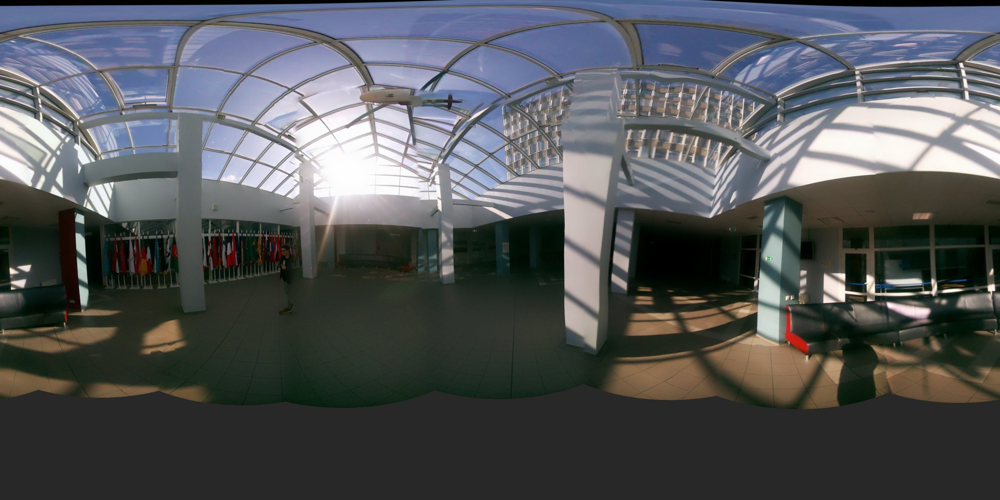
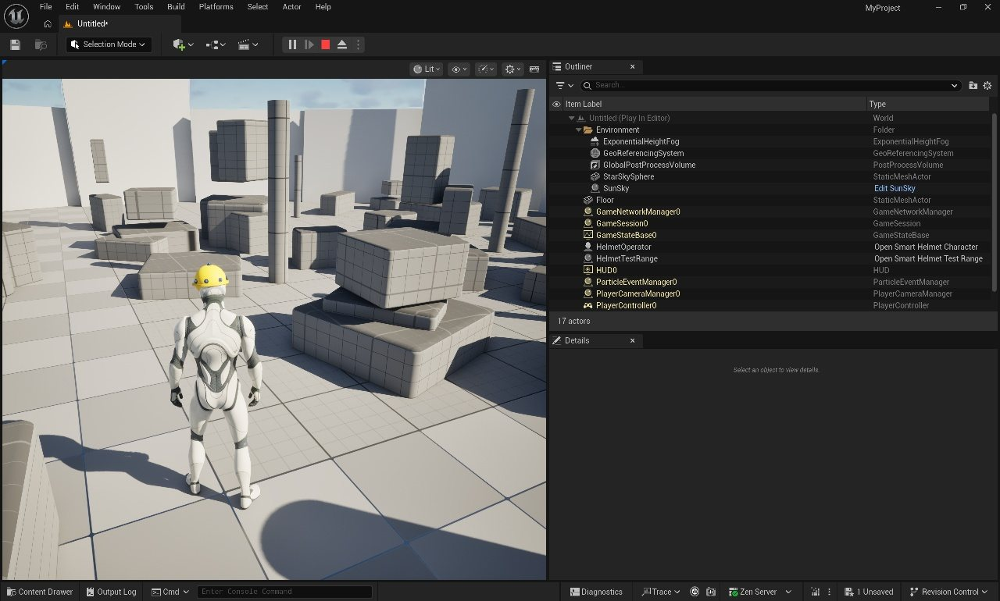
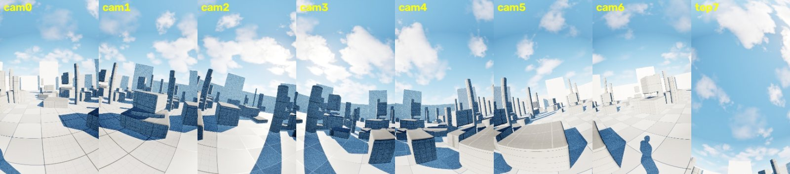
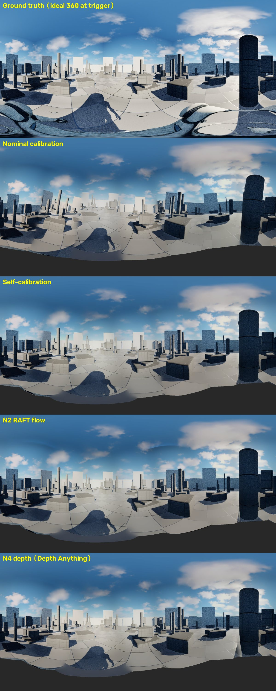
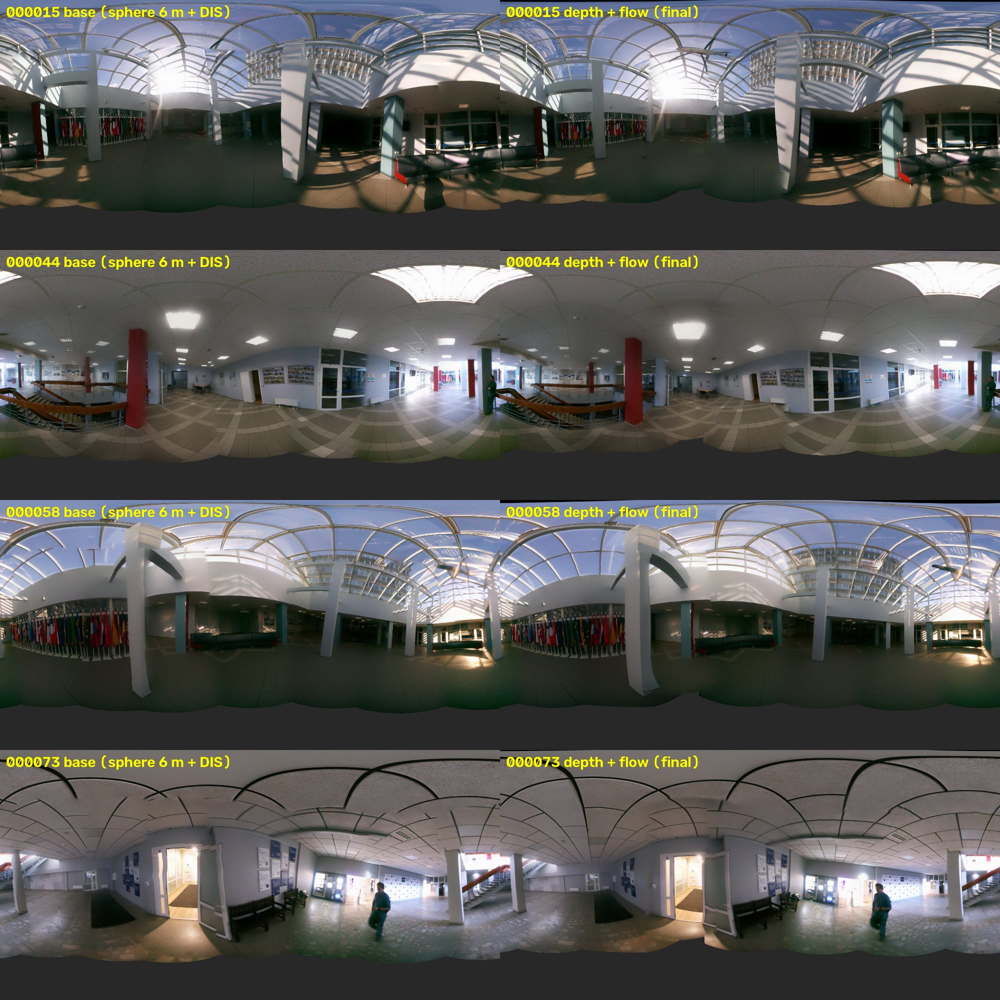
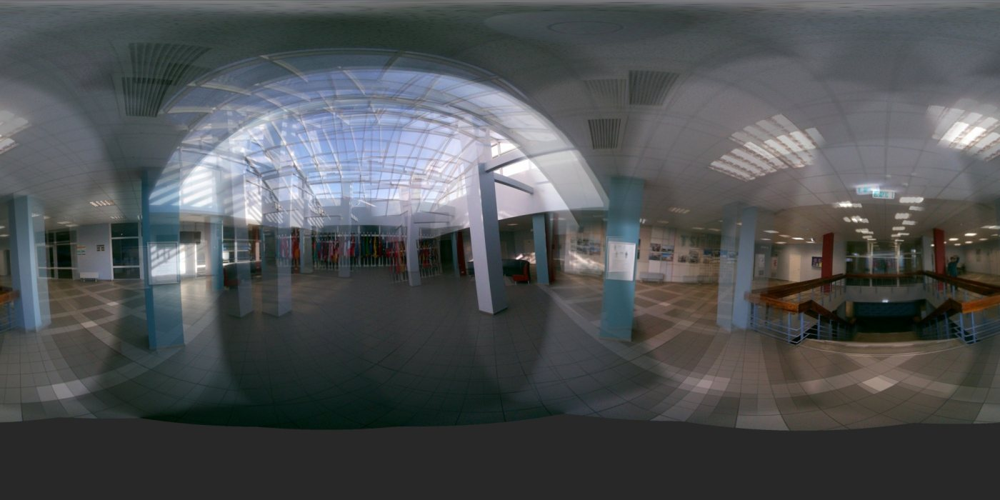
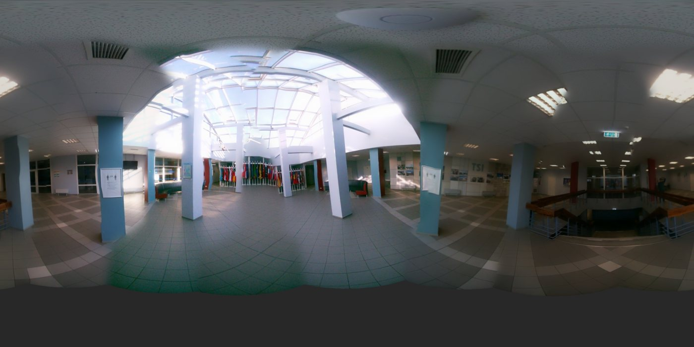

# Smart Helmet 360: симуляция в UE5 + MCP и сшивка панорам OpenCV

Цифровой двойник каски с 8 камерами (7 по кругу + 1 в зенит, Raspberry Pi, объективы fisheye ~175°, IMU BNO055).
В него входят:
- **Unreal Engine 5.8.** Оператор в каске, синхронная съёмка 8 камер, модель неточностей реального железа и эталонная 360°-съёмка. Всё управляется через **MCP** (встроенный сервер UE 5.8 плюс свой набор инструментов).
- **Конвейер «док-станции» на Python/OpenCV.** Загрузка сессий Raspberry Pi с починкой синхронизации, контроль качества снимков, самокалибровка без шахматной доски, фотометрия по tuning-файлу libcamera, сшивка в эквипрямоугольную панораму. Есть MCP-сервер `smart-helmet`.
- **Исследование.** Как снимает и стыкует Google Street View; обзор научных работ по оптическому потоку; проверка 5 направлений на UE (с эталоном) и на реальных кадрах.


*Реальный шлем, атриум: итоговый режим «глубина», 4096×2048.*

## Главные результаты
| Что | Результат |
|---|---|
| Геометрия по схеме | Кольцо видит от −61.4° до +80°, перекрытие соседних камер 30°, покрыто 93.7% сферы (надир не виден) |
| Проекция | **Сфера, а не плоскость.** Fisheye-пиксель сразу превращается в луч, промежуточной плоскости нет. Плоскость + `cv2.Stitcher` связывает 2–4 камеры из 8 или разваливается ([07](Docs/media/07_plane_vs_sphere_projection.jpg)) |
| Самокалибровка реального шлема | Диагональ FOV **174.8°** при паспортных 175° (Arducam IMX219 M12). Измерены ошибки установки: азимут −5…+11°, наклон +1…+5.6° |
| Самокалибровка в UE (истина известна) | Ошибка поворота камер 3–10° (номинал) → **0.15–0.55°** |
| Реальные данные, 1257 фото | Часы Pi сбиты на 4 ч, fake-hwclock наложил 5 сессий, 44 пустых файла, экспозиция камер различается до 7 раз. Всё обработано, получено 73 синхронных кадра |
| Критерий программы испытаний (артефакты < 10% центральной площади) | UE 0.4–2.7%; реальный шлем **0.27–1.0%** в итоговом режиме |
| Лучший метод швов | **Глубина (Depth Anything V2 + триангуляция по потоку) + глобальная сплайновая подгонка.** На реальных кадрах швы 1.65% → 0.80%. Подробно: [Docs/RESULTS.md](Docs/RESULTS.md) |

| UE: оператор и 8 камер | UE: эталон против методов |
|---|---|
|   |  |

| Реальный шлем: база против итогового режима | Фотометрия: до и после |
|---|---|
|  |   |

## Документы
- [Docs/SIMULATION.md](Docs/SIMULATION.md) — как проходила симуляция, инструменты, модель неточностей, ход работы.
- [Docs/RESULTS.md](Docs/RESULTS.md) — сравнение направлений 1–5 на UE (датасеты A/B с эталоном) и на реальных кадрах.
- [Docs/optical_flow_review.md](Docs/optical_flow_review.md) — обзор литературы по оптическому потоку для сшивки 360°.
- [Docs/results/](Docs/results/) — сырые метрики, отчёты калибровки, проверка системы.
- [Docs/media/](Docs/media/) — все иллюстрации.

## Структура
```
MyProject/                 UE 5.8 (только Source, Config, .uproject; ассеты копируются из шаблонов движка)
  Source/MyProject/SmartHelmet/   SmartHelmetComponent (8 камер, LUT fisheye, неточности, IMU), Character, GameMode, TestRange
  Source/MyProjectEditor/         SmartHelmetToolset: MCP-инструменты каски
Tools/
  smart_helmet_pano/       rig, stitch, advanced (режим «глубина»), calibrate, photometric, ingest, health,
                           quality, level, undistort, synth, cli
  smart_helmet_mcp.py      MCP-сервер «док-станции» (15 инструментов)
  ue_mcp.py, ue_build_scene.py, setup_ue_assets.py, check_all.py
  experiments/             directions.py, ue_dataset.py, ue_eval.py, real_eval.py, plane_vs_sphere.py
Data/imx219_160d.json      tuning-файл libcamera (гамма ISP, ALSC)
```

## Быстрый старт
```bash
python -m venv .venv && .venv/Scripts/pip install -r requirements.txt   # torch с CUDA — см. requirements.txt
cd Tools
python -m smart_helmet_pano synth ../Output/synth --frames 2              # синтетика с параллаксом
python -m smart_helmet_pano stitch ../Output/synth --width 2048
# реальный шлем: папки cam1..cam8 с Raspberry Pi
python -m smart_helmet_pano health    <raw_root>
python -m smart_helmet_pano ingest    <raw_root> ../Output/real_helmet
python -m smart_helmet_pano calibrate ../Output/real_helmet --frames 16
python -m smart_helmet_pano stitch    ../Output/real_helmet --real --width 4096   # режим «глубина» на GPU, без GPU — базовый
python check_all.py                                                     # проверка всей системы
```

**Unreal.** Выполнить `python Tools/setup_ue_assets.py`, открыть `MyProject/MyProject.uproject`, затем `python Tools/ue_build_scene.py`. Клавиши в Play: `C` — снимок, `T` — автосъёмка каждые 5 с, `V` — вид с каски.

**MCP в Claude Code:**
```bash
claude mcp add --transport http unreal http://localhost:8000/mcp
claude mcp add smart-helmet -- <venv>/python.exe Tools/smart_helmet_mcp.py
```

## Рекомендации по железу (по результатам)
1. Аппаратный триггер или NTP плюс RTC на всех Pi. Рассинхрон до 1 с — главный источник ошибок и портит самокалибровку.
2. Фиксированные экспозиция и баланс белого, которые рассылает ведущая Pi (`AeEnable=False`, `AwbEnable=False`).
3. Разовая калибровка каждой камеры по ChArUco: у объективов разная дисторсия, по сцене её не разделить. Самокалибровку оставить для подстройки в поле.
4. Проверка записи снимков (`fsync`, контроль размера файла) и валидация кватернионов BNO055.
